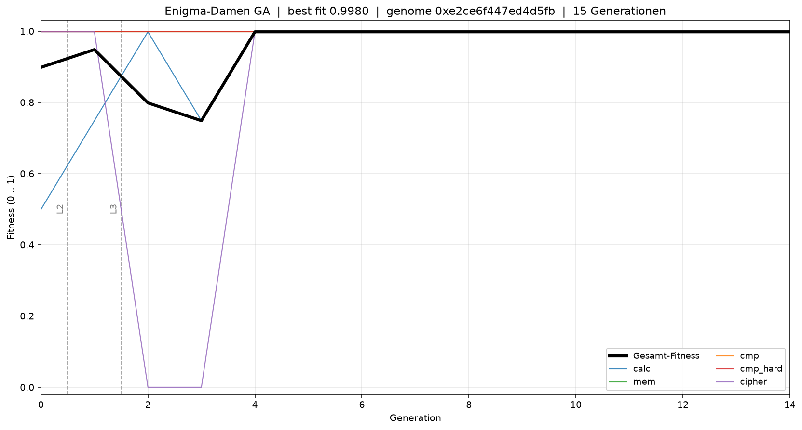

# Fragezeichen

Ein cocotb-Harness, das einen genetischen Algorithmus gegen drei verschiedene
Verilog-DUTs laufen lässt — mit einer positiven Kontrolle, einer negativen
Kontrolle und einem ehrlichen Negativergebnis.

**Was das nicht ist:** kein Durchbruch in evolvierbarer Hardware. Was es ist:
ein funktionierendes Framework mit dokumentierten Grenzen.

## Die drei DUTs

| DUT | Genom | Ergebnis | Was es zeigt |
|-----|-------|----------|--------------|
| `mini_alu.v` | 8 wirksame Bits (Muxe) | 0.90 → 0.998 | Pipeline funktioniert, Gradient trivial |
| `blind_seed.v` | xorshift-Seed | flach ~0.02–0.25 | Negativkontrolle: kein Gradient, GA irrt |
| `cgp_alu.v` | 110 Bit (11 Gatter-Knoten) | 0.78 → 0.84, dann Plateau | Echte Epistasis, premature convergence |

## Das Bild



Links `mini_alu`: schwarze Linie klettert, mit violettem cipher-Dip bei Gen 2–3
(der GA muss Bit 7 zerstören, um L3 zu lösen). Rechts `blind_seed`: graue Linie
flach, Zufallsspikes ohne Struktur.

## Reproduktion

```bash
python -m venv .venv && source .venv/bin/activate
pip install "cocotb>=1.9"
pkg install -y iverilog matplotlib python-numpy   # Termux; sonst apt/dnf
sed -i 's/include-system-site-packages = false/include-system-site-packages = true/' .venv/pyvenv.cfg

make clean && make DUT=mini_alu POP=8 GENS=15 EPS=4 SEED=1
cp results.json results_seed1.json

make clean && make DUT=blind_seed POP=8 GENS=15 EPS=4 SEED=1
cp results.json results_blind_seed1.json

python plot.py
```

## Der CGP-Befund

`cgp_alu.v` ist ein Cartesian-Genetic-Programming-DUT: 11 Knoten, jeder mit
4-Bit-Selektoren auf A/B/vorherige Knoten und einer 2-Bit-Funktion
(AND/OR/XOR/NAND). Genom = 110 Bit. Aufgabe: 3-Bit-Vergleich `A > B` über
alle 64 Eingabepaare.

### Was gemessen wurde

Mit Hamming-Fitness (Zahl der richtigen Paare):

| Aufgabe | Zufallssuche | GA (1+4, 1-3-Bit-Mutation) |
|---------|--------------|----------------------------|
| `ne3` (A≠B) | 0/10 gelöst | 1/10 |
| `gt2` (2-Bit) | 0/10 | 0/10 |
| `gt3` (3-Bit) | 0/10 | 0/10 |

Mit balanced Fitness (Mittel aus Sensitivität und Spezifität):

| Aufgabe | Zufallssuche | GA |
|---------|--------------|-----|
| `ne3` | 0/10 | **6/10** |
| `gt2` | 0/10 | **7/10** |
| `gt3` | 0/10 | 0/10 (Median 60/64) |

200.000 Evaluationen pro Lauf, 10 Seeds, `tools_cgp_modell.py`.

### Warum Hamming deceptive ist

`ne3` hat eine Klassenverteilung von 56:8. Die Konstante "1" macht
56/64 richtig — mehr als jede partielle XOR-Struktur. Der Fitness-Gradient
zeigt **weg** von der Lösung. Erst balancierte Fitness entwertet die
Konstanten und macht echte Struktur belohnbar.

### gt3: lösbar, aber nicht gefunden

Ein Handgenom (Ripple-Carry-Comparator, 10 Gatter in 11 Knoten) löst `gt3`:

    Modell:  64/64
    Verilog: 64/64  (VERIFY_GENOME=0x3fdebb70b294aa7a6071906060c2, fit=0.998)

Der GA findet diese Lösung nicht in 200.000 Evaluationen. Median 60/64,
Maximum 62/64 — nah dran, aber die letzten Bits erfordern eine grundlegend
andere Schaltung. Das ist premature convergence auf einem lokalen Optimum.

## Was das zeigt

1. **Das Harness funktioniert.** mini_alu konvergiert, blind_seed nicht.
2. **Der GA funktioniert auf richtigen Landschaften.** balanced Fitness
   löst ne3 und gt2.
3. **Fitness-Design ist der entscheidende Hebel.** Hamming → 0/10,
   balanced → 6-7/10. Gleicher GA, gleiches Budget.
4. **Einfache (1+4)-Evolution reicht nicht für epistatische Landschaften.**
   gt3 ist lösbar, aber 1-3-Bit-Mutation findet die Lösung nicht.

## Dateien

    host.py                  cocotb-Testbench + GA + 6 Tasks
    mini_alu.v               8-Bit-Mux-DUT (trivialer Gradient)
    blind_seed.v             xorshift-Stub (Negativkontrolle)
    cgp_alu.v                11-Knoten-CGP-DUT (110 Bit)
    tools_cgp_modell.py      Python-Modell, balanced/unbalanced Fitness
    plot.py                  convergence.png aus results_*.json
    Makefile                 DUT ?= mini_alu

## Lizenz

Die CGP-Ideen stammen von Miller, Thompson und Kollegen. Der Code ist
frei verwendbar.

## Strategievergleich: GA vs. Zufall vs. Curriculum

Gleiche Aufgabe (4-Bit-Addierer, 18 Knoten), gleiches Budget.
Zwei Budgets, um zu pruefen, ob Rechenzeit die Grenze ist.

| Stufe | 30k Evals | 100k Evals |
|-------|-----------|------------|
| Reine Zufallssuche | 0.6964 | 0.7232 |
| GA direkt (kein Curriculum) | 0.8177 | **0.8333** |
| GA + Curriculum (1-2-3-4 Bit) | 0.7034 | 0.7113 |
| GA + Curriculum + Random Restart | 0.7619 | 0.8135 |

Median ueber 3 bzw. 5 Seeds. 0/5 loesen den Addierer.

### Befunde

1. **Der GA ist besser als Zufall.** +0.11 bei beiden Budgets.
   Der erste saubere Beleg, dass Evolution hier etwas bringt.
2. **Das Curriculum schadet.** 0.71 mit vs 0.83 ohne.
   Die Population konvergiert auf jeder Stufe und kann die
   naechste nicht mehr lernen - Diversitaetsverlust.
3. **Random Restart repariert das fast.** 0.71 -> 0.81.
   Frischer Zufall bei Stagnation holt die Population raus.
4. **3,3x mehr Budget bringt fast nichts.** +0.01 bis +0.05.
   Die Landschaft ist bei 100k Evals gesaettigt.
5. **Niemand loest den Addierer.** Trotz Handgenom-Beweis
   (fit=1.0). Der GA findet die Loesung nicht.

### Was dieser Vergleich zeigt

Das Curriculum war eine intuitive, aber falsche Idee: "vom Einfachen
zum Schweren" zerstoert die Populationsdiversitaet. Der GA direkt
ist die bessere Strategie. Random Restart ist ein billiger Fix.

Die Grenze liegt nicht am Budget (100k Evals = +0.02 bis +0.05),
nicht an der Kapazitaet (Handgenom loest den 4-Bit-Addierer mit
18 Knoten), sondern an der Suchstrategie des einfachen GA auf
epistatischen Landschaften.

Was fehlt: groessere Populationen (POP=200+), mehr Knoten (30+),
neutrale Mutation als primaerer Operator, Inselmodelle. Das sind
Standard-CGP-Techniken, die hier nicht implementiert sind.
