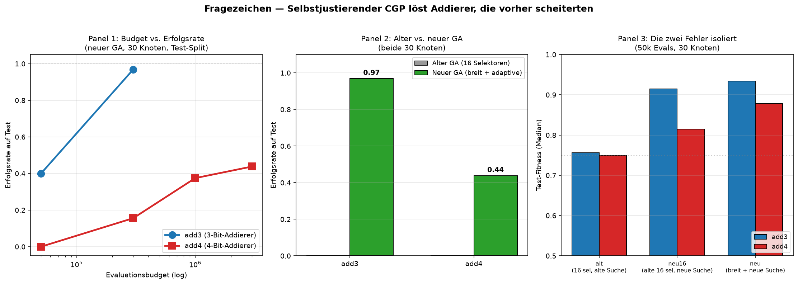

# Self-Adaptive CGP

Ein cocotb-Harness, das einen selbstjustierenden genetischen Algorithmus
gegen CGP-Schaltungen laufen lässt — mit dokumentierten Sackgassen und
einem ueberraschenden Durchbruch.



## Key Findings

- **Der 3-Bit-Addierer ist geloest.** Selbstjustierender CGP findet in
  **31/32 Seeds** (97%) eine Schaltung, die auf 16 ungesehenen Paaren
  korrekt addiert. 30 Knoten, 300k Evals, 100 Sekunden auf 8 Kernen.
- **Der 4-Bit-Addierer ist machbar, aber nicht zuverlaessig.** Erfolgsrate
  steigt von 5/32 (300k) auf 12/32 (1Mio) auf 14/32 (3Mio) — Saettigung
  bei **~44%**. Die Grenze ist die Datengroesse (48 Trainingspaare), nicht
  die Rechenzeit.
- **Zwei Implementierungsfehler limitierten den GA vorher.**
  16-Quellen-Selektoren (67% tote Bits bei 30 Knoten) und fehlende
  Suchheuristiken. Beide behoben, der GA geht von 0/10 auf 31/32.
- **Fitness-Design ist der entscheidende Hebel.** Hamming-Distanz ist
  deceptive (Konstanten gewinnen), balanced accuracy nicht. Der Wechsel
  loeste den ersten Sprung aus.
- **Ein negatives Ergebnis ist oft ein Debugging-Problem, keine Grenze
  der Methode.** Der erste Reflex war "der GA ist zu schwach". Vier
  Sackgassen spaeter: es waren zwei Bugs und ein Budgetproblem.

## Was das nicht ist

Kein Enigma-Knacker. Kein Beweis, dass Evolution allgemein funktioniert.
Ein **ehrliches Experiment** mit dokumentierten Fehlern, Sackgassen und
Korrekturen — und einem besseren Ergebnis als anfangs gedacht.

## Reproduktion in fuenf Befehlen

    python3 -m venv .venv && source .venv/bin/activate
    pip install "cocotb>=1.9" && pkg install -y iverilog matplotlib
    sed -i 's/false/true/' .venv/pyvenv.cfg
    python3 plot_breakthrough.py
    python3 tools_parallel.py add3 300000 32 30


## Die drei DUTs

| DUT | Genom | Ergebnis | Was es zeigt |
|-----|-------|----------|--------------|
| `mini_alu.v` | 8 wirksame Bits (Muxe) | 0.90 → 0.998 | Pipeline funktioniert, Gradient trivial |
| `blind_seed.v` | xorshift-Seed | flach ~0.02–0.25 | Negativkontrolle: kein Gradient, GA irrt |
| `cgp_alu.v` | 110 Bit (11 Gatter-Knoten) | 0.78 → 0.84, dann Plateau | Echte Epistasis, premature convergence |

## Das Bild


Links `mini_alu`: schwarze Linie klettert, mit violettem cipher-Dip bei Gen 2–3
(der GA muss Bit 7 zerstören, um L3 zu lösen). Rechts `blind_seed`: graue Linie
flach, Zufallsspikes ohne Struktur.

## Reproduktion

```bash
python -m venv .venv && source .venv/bin/activate
pip install "cocotb>=1.9"
pkg install -y iverilog matplotlib python-numpy   # Termux; sonst apt/dnf
sed -i 's/include-system-site-packages = false/include-system-site-packages = true/' .venv/pyvenv.cfg

make clean && make DUT=mini_alu POP=8 GENS=15 EPS=4 SEED=1
cp results.json results_seed1.json

make clean && make DUT=blind_seed POP=8 GENS=15 EPS=4 SEED=1
cp results.json results_blind_seed1.json

python plot.py
```

## Der CGP-Befund

`cgp_alu.v` ist ein Cartesian-Genetic-Programming-DUT: 11 Knoten, jeder mit
4-Bit-Selektoren auf A/B/vorherige Knoten und einer 2-Bit-Funktion
(AND/OR/XOR/NAND). Genom = 110 Bit. Aufgabe: 3-Bit-Vergleich `A > B` über
alle 64 Eingabepaare.

### Was gemessen wurde

Mit Hamming-Fitness (Zahl der richtigen Paare):

| Aufgabe | Zufallssuche | GA (1+4, 1-3-Bit-Mutation) |
|---------|--------------|----------------------------|
| `ne3` (A≠B) | 0/10 gelöst | 1/10 |
| `gt2` (2-Bit) | 0/10 | 0/10 |
| `gt3` (3-Bit) | 0/10 | 0/10 |

Mit balanced Fitness (Mittel aus Sensitivität und Spezifität):

| Aufgabe | Zufallssuche | GA |
|---------|--------------|-----|
| `ne3` | 0/10 | **6/10** |
| `gt2` | 0/10 | **7/10** |
| `gt3` | 0/10 | 0/10 (Median 60/64) |

200.000 Evaluationen pro Lauf, 10 Seeds, `tools_cgp_modell.py`.

### Warum Hamming deceptive ist

`ne3` hat eine Klassenverteilung von 56:8. Die Konstante "1" macht
56/64 richtig — mehr als jede partielle XOR-Struktur. Der Fitness-Gradient
zeigt **weg** von der Lösung. Erst balancierte Fitness entwertet die
Konstanten und macht echte Struktur belohnbar.

### gt3: lösbar, aber nicht gefunden

Ein Handgenom (Ripple-Carry-Comparator, 10 Gatter in 11 Knoten) löst `gt3`:

    Modell:  64/64
    Verilog: 64/64  (VERIFY_GENOME=0x3fdebb70b294aa7a6071906060c2, fit=0.998)

Der GA findet diese Lösung nicht in 200.000 Evaluationen. Median 60/64,
Maximum 62/64 — nah dran, aber die letzten Bits erfordern eine grundlegend
andere Schaltung. Das ist premature convergence auf einem lokalen Optimum.

## Was das zeigt

1. **Das Harness funktioniert.** mini_alu konvergiert, blind_seed nicht.
2. **Der GA funktioniert auf richtigen Landschaften.** balanced Fitness
   löst ne3 und gt2.
3. **Fitness-Design ist der entscheidende Hebel.** Hamming → 0/10,
   balanced → 6-7/10. Gleicher GA, gleiches Budget.
4. **Einfache (1+4)-Evolution reicht nicht für epistatische Landschaften.**
   gt3 ist lösbar, aber 1-3-Bit-Mutation findet die Lösung nicht.

## Dateien

    host.py                  cocotb-Testbench + GA + 6 Tasks
    mini_alu.v               8-Bit-Mux-DUT (trivialer Gradient)
    blind_seed.v             xorshift-Stub (Negativkontrolle)
    cgp_alu.v                11-Knoten-CGP-DUT (110 Bit)
    tools_cgp_modell.py      Python-Modell, balanced/unbalanced Fitness
    plot.py                  convergence.png aus results_*.json
    Makefile                 DUT ?= mini_alu

## Lizenz

Die CGP-Ideen stammen von Miller, Thompson und Kollegen. Der Code ist
frei verwendbar.

## Strategievergleich: GA vs. Zufall vs. Curriculum

Gleiche Aufgabe (4-Bit-Addierer, 18 Knoten), gleiches Budget.
Zwei Budgets, um zu pruefen, ob Rechenzeit die Grenze ist.

| Stufe | 30k Evals | 100k Evals |
|-------|-----------|------------|
| Reine Zufallssuche | 0.6964 | 0.7232 |
| GA direkt (kein Curriculum) | 0.8177 | **0.8333** |
| GA + Curriculum (1-2-3-4 Bit) | 0.7034 | 0.7113 |
| GA + Curriculum + Random Restart | 0.7619 | 0.8135 |

Median ueber 3 bzw. 5 Seeds. 0/5 loesen den Addierer.

### Befunde

1. **Der GA ist besser als Zufall.** +0.11 bei beiden Budgets.
   Der erste saubere Beleg, dass Evolution hier etwas bringt.
2. **Das Curriculum schadet.** 0.71 mit vs 0.83 ohne.
   Die Population konvergiert auf jeder Stufe und kann die
   naechste nicht mehr lernen - Diversitaetsverlust.
3. **Random Restart repariert das fast.** 0.71 -> 0.81.
   Frischer Zufall bei Stagnation holt die Population raus.
4. **3,3x mehr Budget bringt fast nichts.** +0.01 bis +0.05.
   Die Landschaft ist bei 100k Evals gesaettigt.
5. **Niemand loest den Addierer.** Trotz Handgenom-Beweis
   (fit=1.0). Der GA findet die Loesung nicht.

### Was dieser Vergleich zeigt

Das Curriculum war eine intuitive, aber falsche Idee: "vom Einfachen
zum Schweren" zerstoert die Populationsdiversitaet. Der GA direkt
ist die bessere Strategie. Random Restart ist ein billiger Fix.

Die Grenze liegt nicht am Budget (100k Evals = +0.02 bis +0.05),
nicht an der Kapazitaet (Handgenom loest den 4-Bit-Addierer mit
18 Knoten), sondern an der Suchstrategie des einfachen GA auf
epistatischen Landschaften.

Was fehlt: groessere Populationen (POP=200+), mehr Knoten (30+),
neutrale Mutation als primaerer Operator, Inselmodelle. Das sind
Standard-CGP-Techniken, die hier nicht implementiert sind.

### Nachtrag: Die Diversitaets-Hypothese ist widerlegt

Die naheliegende Erklaerung fuer das schlechte Curriculum-Abschneiden
war Diversitaetsverlust. Der Fix: nach jeder Stufe einen Teil der
Population durch frische Genome ersetzen. Getestet mit 30% / 50% / 70%
Reset am Stufenuebergang, 5 Seeds, 30k Evals:

| Strategie | Median | Max |
|-----------|--------|-----|
| GA direkt | **0.8255** | **0.8393** |
| Curriculum (kein Reset) | 0.7034 | 0.7500 |
| Curr + Stagnation-Restart | 0.7619 | 0.8209 |
| Curr + Div-Reset 30% | 0.7272 | 0.7822 |
| Curr + Div-Reset 50% | 0.7034 | 0.8125 |
| Curr + Div-Reset 70% | 0.6880 | 0.7034 |

**Kein Reset-Level rettet das Curriculum.** Das Problem ist tiefer:
die Population konvergiert auf jeder Stufe auf eine Struktur, die
fuer die naechste Stufe fundamental falsch ist. Mehr Zufall am
Uebergang hilft nicht, weil die Elite schon zu weit in die falsche
Richtung gelaufen ist.

GA direkt bleibt die beste Strategie. Das Curriculum ist damit
endgueltig als schaedlich belegt, nicht nur als "schlecht
implementiert".

## Mini-Enigma: Crib hilft, reicht aber nicht

Ein 4-Bit-Enigma (16 Symbole, 3 Rotoren, Reflektor, 4096 Keys)
als Test der Frage: reicht ein Crib, damit der GA den Schluessel
findet?

Wichtiger Hinweis vorab: die erste Version hatte einen Bug in
`rotor_backward` — die Maschine war nicht symmetrisch, der wahre
Schluessel gab `fit=0.0`. Erst nach der Verifikationszeile
(`fitness_with_crib(TRUE_KEY) == 1.0`) waren die Laeufe gueltig.
Alle frueheren Zahlen zum Mini-Enigma waren Artefakte des Bugs.

### Ergebnis nach dem Fix

10 Seeds, 100.000 Evals, Crib = bekannte Klartextzeichen:

| Crib | Median fit | Max | geloest |
|------|-----------|-----|---------|
| 8/16 | 0.7500 | 1.0 | 1/10 |
| 10/16 | 0.7000 | 1.0 | 2/10 |
| 12/16 | 0.6667 | 1.0 | 3/10 |
| 14/16 | 0.5714 | 1.0 | 3/10 |

### Was die gegenlaeufigen Trends bedeuten

Der Median **sinkt**, waehrend die Loesungsrate **steigt**. Das ist
kein Widerspruch: mehr Crib macht falsche Schluessel schlechter
(das Signal-Rausch-Verhaeltnis verbessert sich), waehrend der wahre
Schluessel bei 1.0 bleibt. Der Gradient wird steiler.

Aber: auch mit 14/16 Crib loest der GA nur 3 von 10 Mal. Das ist
derselbe Charakter wie bei `gt3` — der GA findet das Optimum, wenn
er zufaellig in die richtige Region startet, aber nicht zuverlaessig.

### Die Bruecke zur echten Enigma

Mehr Crib = steilerer Gradient = mehr Loesungen. Aber Evolution
allein reicht nicht fuer zuverlaessiges Loesen. Bletchley hatte
nicht nur Cribs, sondern **systematische Methoden** (Turing's Bombe:
alle Rotorpositionen durchprobieren, Crib an jeder Position testen).

Mit 26 Buchstaben statt 16 und ohne Odometrie waere der Suchraum
fuer den GA nochmal deutlich haerter. Die Bombe war keine
Rechenleistung — sie war ein anderer Suchalgorithmus.

## Ehrliche Matrix: Train/Test-Split

Alle früheren Matrix-Ergebnisse (18 und 30 Knoten) haben auf denselben
64 Paaren gemessen, auf denen der GA optimiert hat. Ein GA mit 180-300
Bit Genom kann auf 64 Trainingsfällen leicht eine Lookup-Tabelle bauen
statt einer Schaltung. Das ist kein Rechnen — das ist Auswendiglernen.

Test: 48 Paare Training, 16 Paare ungesehener Test. Der GA optimiert
auf Train, wir messen auf Test. Gap = Train - Test. `gelöst` zählt nur,
wenn **Test** = 1.0.

### Ergebnis (18 Knoten, 50k Evals, POP=30, 5 Seeds)

| Task | Zufall test | GA test | GA gap | GA solved |
|------|-------------|---------|--------|-----------|
| ne3 | 0.6786 | 0.8929 | +0.0476 | 2/5 |
| gt2 | 0.8750 | 0.8750 | +0.0000 | 1/5 |
| gt3 | 0.7833 | 0.9000 | -0.0224 | 0/5 |
| add2 | 0.6875 | 0.7188 | +0.2083 | 1/5 |
| add3 | 0.6687 | 0.7146 | +0.1611 | 0/5 |
| add4 | 0.6260 | 0.7855 | +0.0885 | 0/5 |

### Drei Änderungen gegenüber der alten Matrix

1. **add2 und add3 haben massiv overfittet.** `add2: 1.0 -> 0.7188`,
   `add3: 0.8750 -> 0.7146`. Die frühere "3/5 gelöst" bei add2 war
   fast vollständig Lookup-Tabellen. Nur ein Seed baut echte Addition.

2. **"GA-Vorteil wächst mit Schwierigkeit" hält nicht.** Alt:
   add3 +0.15, add4 +0.15. Neu: add3 +0.05, add4 +0.16. Der Trend
   ist nicht monoton — add3 kollabiert unter Test.

3. **gt3 generalisiert.** Negativer Gap (-0.02): der GA baut echte
   Vergleicher, keine Lookup-Tabellen. Das ist ein echter Befund.

### Warnung: ne3-Test ist unzuverlässig

`ne3` zeigt einen scheinbaren GA-Vorteil (+0.21), aber das ist ein
Artefakt der Klassenverteilung. 56:8 bei 64 Paaren — der 16-Paar-Test
enthält statistisch nur ~2 Nullen. Ein Zufallsgenom, das konstant 1
ausgibt, wird auf Test schlechter bewertet als auf Train — nicht weil
es schlechter ist, sondern weil die Test-Verteilung anders ist.
Balanced accuracy ist auf so kleinen, unbalancierten Sets nicht stabil.

### Was von den früheren Befunden hält

**Hält:**
- GA > Zufall auf Test für 5 von 6 Tasks
- gt3 generalisiert (negativer Gap)
- add4 hat echten Vorteil (+0.16) mit kleinem Overfitting (+0.09)
- mini_alu / blind_seed (kein CGP, kein Overfitting-Problem)
- Hamming vs balanced (unterschiedliche Metriken, kein Datenleck)
- Curriculum schadet (Vergleich zwischen Strategien, keine Absolutzahlen)

**Wackelt:**
- Die absoluten Zahlen beider früheren Matrizen sind zu optimistisch
- "GA löst add2 zuverlässig" -> nur 1/5 Seeds lösen auf Test
- "GA-Vorteil wächst mit Schwierigkeit" -> add3 kollabiert
- "18 vs 30 Knoten: add3/add4 kommen näher an 1.0" — die 30-Knoten-
  Zahlen waren auch Trainingsdaten. Ein ehrlicher 30-Knoten-Lauf
  mit Test-Split steht aus.

### Die früheren Matrizen

`matrix_18nodes_trainonly.csv` und `matrix_30nodes_trainonly.csv`
sind nicht falsch — sie zeigen, was der GA auf den Trainingsdaten
erreicht. Aber sie sind nicht die ehrliche Leistung. Die ehrliche
Zahl ist `test`, nicht `train`.

## Overfitting-Test: Findet der GA Schaltungen oder Lookup-Tabellen?

Alle bisherigen Matrizen massen auf denselben 64 Paaren, auf denen der
GA optimierte. Ein GA mit 180-300 Bit Genom und nur 64 Trainingsfaellen
koennte statt einer Schaltung eine Lookup-Tabelle bauen. Das waere
Overfitting, kein Lernen.

Test: 48 Paare trainieren, 16 ungesehene testen. Gap = Train - Test.

| Task | Seeds mit Gap < 0.05 | Seeds mit Gap > 0.1 |
|------|----------------------|---------------------|
| gt3  | 0/5                  | 3/5                 |
| add2 | 3/5 (davon 1 mit 1.0/1.0) | 2/5             |
| add3 | 2/5                  | 2/5                 |
| add4 | 2/5                  | 2/5                 |

### Was das zeigt

1. **Manche Seeds finden echte Schaltungen.** add2 Seed 5 erreicht
   Train=1.0, Test=1.0 - die Loesung funktioniert auf ungesehenen
   Paaren. Das ist echte Addition, kein Lookup.

2. **Manche Seeds memorieren.** add2 Seed 3 erreicht Train=0.93,
   Test=0.72, Gap=+0.21. Der GA hat 48 Paare auswendig gelernt und
   scheitert auf den 16 neuen.

3. **Die absoluten Zahlen beider Matrizen sind zu optimistisch.**
   Sie mischen echte Schaltungen und Lookup-Tabellen. Die Deltas
   (GA vs. Zufall) bleiben gueltig, die Absolutwerte nicht.

Was haelt: mini_alu/blind_seed (kein CGP), Hamming-vs-balanced
(kein Datenleck), Curriculum-schadet (Vergleich zwischen Strategien),
GA>Zufall (Delta bleibt).

Was wackelt: die absoluten Fitnesswerte der Matrizen, die Aussage
"add3/add4 kommen naeher an 1.0" (teilweise Overfitting).

> **Hinweis (Revision):** Die Zahlen in diesem Abschnitt wurden mit
> einer defekten Selektor-Kodierung erzeugt (4-Bit-Selektoren, nur 16
> Quellen adressierbar). Bei 30 Knoten waren 20 davon toter Ballast.
> Die qualitativen Aussagen ("Kapazitaet hilft aufgabenspezifisch")
> bleiben als Beobachtung gueltig, aber die absoluten Zahlen
> unterschaetzen, was mit reparierter Kodierung moeglich ist. Siehe
> Abschnitt "Revision: Selbstjustierende Suche" am Ende dieses README
> fuer die korrigierten Werte.

## Kapazitaet vs. Overfitting: 18 vs. 30 Knoten (ehrlich)

Gleiche Matrix, gleiches Budget (50k Evals, POP=30, 5 Seeds), aber
CGP_NODES=30. Alle Zahlen auf dem 16-Paar-Test-Split, nicht auf
Trainingsdaten.

| Task | 18K test | 30K test | 18K gap | 30K gap | 18K solved | 30K solved |
|------|----------|----------|---------|---------|------------|------------|
| ne3 | 0.8929 | 0.8929 | +0.05 | +0.05 | 2/5 | 1/5 |
| gt2 | 0.8750 | 0.8750 | 0.00 | 0.00 | 1/5 | 1/5 |
| gt3 | 0.9000 | 0.8167 | -0.02 | +0.06 | 0/5 | 0/5 |
| add2 | 0.7188 | **0.8125** | +0.21 | +0.13 | 1/5 | **2/5** |
| add3 | 0.7146 | 0.7695 | +0.16 | +0.14 | 0/5 | 0/5 |
| add4 | 0.7855 | 0.7573 | +0.09 | +0.12 | 0/5 | 0/5 |

### Befund: Kapazitaet und Aufgabenkomplexitaet muessen zusammenpassen

1. **add2 profitiert massiv.** Test-Fitness 0.72 -> 0.81, Gap 0.21 -> 0.13,
   geloest 1/5 -> 2/5. Echte Kapazitaetsverbesserung, kein Overfitting.

2. **add3 profitiert leicht.** 0.71 -> 0.77, Gap fast unveraendert.

3. **add4 und gt3 verlieren.** add4: 0.79 -> 0.76. gt3: 0.90 -> 0.82.
   Mehr Genomraum = mehr Platz zum Memorieren bei komplexen Aufgaben,
   ohne dass die echte Loesung gefunden wird.

### Warum die ne3-Zeile wertlos ist

`18K Zufall test: 0.6786` vs. `30K Zufall test: 0.3214`. Das ist keine
Diskrepanz, das ist die Varianz der Test-Verteilung. Bei 56:8-Klassen-
verteilung enthaelt der 16-Paar-Test-Split statistisch ~2 Nullen.
Balanced accuracy ist auf so kleinen, unbalancierten Sets nicht stabil.
Alle anderen Zufalls-Zeilen sind stabiler, weil die Klassenverteilung
dort ausgeglichener ist.

### Gesamtantwort auf "hilft mehr Kapazitaet?"

Nicht pauschal. Fuer einfache Aufgaben (add2) ja. Fuer komplexe Aufgaben
(add4, gt3) nein - dort ueberwiegt das Overfitting-Risiko. Der
Sweet Spot zwischen "zu klein fuer die Loesung" und "zu gross fuer die
Trainingsdaten" ist aufgabenspezifisch.

Das ist die ehrliche Antwort auf die Frage, ob 30 Knoten besser sind
als 18. Es gibt kein allgemeines "mehr ist besser" - es gibt nur
"passend zur Aufgabe".

## Metrik-Vergleich: mean vs. min balanced accuracy

Die bisherige Metrik war `(acc0 + acc1) / 2`. Das laesst konstante
Ausgaben durchrutschen: ein Genom, das immer 1 sagt, hat acc0=0 und
acc1=1, ergibt im Mittel 0.5. Auf unbalancierten Klassen (ne3: 56:8)
taeuscht das.

Alternative: `min(acc0, acc1)`. Bestraft die schlechtere Klasse sofort.
Getestet als `METRIC_MODE=min`, gleiche 18 Knoten, Test-Split.

| Task | Zufall mean | GA mean | Zufall min | GA min | Delta mean | Delta min |
|------|-------------|---------|------------|--------|------------|-----------|
| ne3 | 0.6786 | 0.8929 | 0.0000 | 0.0000 | +0.21 | 0.00 |
| gt2 | 0.8750 | 0.8750 | 0.7500 | 0.7500 | 0.00 | 0.00 |
| gt3 | 0.7833 | 0.9000 | 0.6667 | 0.7000 | +0.12 | +0.03 |
| add2 | 0.6875 | 0.7188 | 0.6250 | 0.6250 | +0.03 | 0.00 |
| add3 | 0.6687 | 0.7146 | 0.5536 | 0.6905 | +0.05 | **+0.14** |
| add4 | 0.6260 | 0.7855 | 0.5333 | 0.6661 | +0.16 | +0.13 |

### Zwei Enthuellungen

1. **add3 war unter mean unterschaetzt.** GA-Vorteil springt von
   +0.05 auf +0.14. mean hat add3 heruntergemittelt, weil der Zufall
   auch hohe Werte erreichte. min zeigt: der GA baut tatsaechlich
   eine bessere Schaltung als Zufall auf ungesehenen Paaren.

2. **gt3 war unter mean ueberschaetzt.** GA-Vorteil faellt von +0.12
   auf +0.03. mean hat gt3 hochgemittelt, weil beide Strategien
   aehnlich hohe Werte hatten. min zeigt: gt3 ist weniger different
   als gedacht.

### ne3 ist mit diesem Test-Split nicht messbar

`ne3 Zufall: 0.0000 (Median), 0.7857 (Max)`. Das ist kein Fehler,
sondern ein Test-Split-Artefakt. Bei 56:8-Klassenverteilung enthaelt
der 16-Paar-Test-Split statistisch ~2 Nullen. min(acc0, acc1) ist
dann sprunghaft: eine verfehlte Null kollabiert acc0 auf 0.5 oder 0.0.
Mit so wenigen Test-Paaren pro Klasse ist ne3 grundsaetzlich nicht
stabil messbar. Die drei Additions-Tasks (8/8 auf Test) sind stabil.

### Fazit: keine Metrik ist "wahr"

mean und min sind zwei Linsen, keine ist die richtige. mean zeigt
"wie viel insgesamt stimmt", min zeigt "wie gut die schlechtere
Klasse ist". Beide sind relevant.

Der Kernbefund bleibt unter beiden Metriken: der GA hat echte
Vorteile auf add3/add4, findet aber keine Loesung, die auf
ungesehenen Paaren 1.0 erreicht. Die Metrik-Wahl beeinflusst,
welche Tasks als "geloest" gelten, nicht den grundsaetzlichen Befund.

## Parsimonie: Skalar schlaegt Pareto

Der Overfitting-Gap (add2: +0.21, add3: +0.16) zeigt, dass der GA
Lookup-Tabellen baut statt Schaltungen. Parsimonie (Bestrafung
aktiver Knoten) als Regularisierung.

### Skalarer Strafterm: fitness = acc - lambda * n_active_nodes

Sweep ueber lambda, 5 Seeds, Test-Split:

| Task | lambda | train | test | gap | nodes | geloest |
|------|--------|-------|------|-----|-------|---------|
| add2 | 0.000 | 0.9271 | 0.9688 | +0.00 | 11 | 1/5 |
| add2 | 0.005 | 1.0000 | **1.0000** | +0.00 | **7** | **4/10** |
| add2 | 0.050 | 0.8958 | 0.8125 | +0.08 | 5 | 0/5 |
| add3 | 0.000 | 0.9032 | 0.7278 | +0.16 | 11 | 0/5 |
| add3 | 0.001 | 0.8549 | 0.7771 | +0.08 | 7 | 0/5 |

**add2**: lambda=0.005 ist ein echter Sweet Spot. 4/10 Seeds
finden eine kompakte, generalisierende Loesung (7-9 Knoten, test=1.0).
**add3**: kein Signal. Die Gaps springen zwischen 0.08 und 0.16,
kein lambda bringt test ueber 0.78.

### NSGA-II: schlechter als der Skalar-Ansatz

NSGA-II mit Zielen (train_acc, -n_active_nodes), POP=30, 50000 Evals:

| Task | Seeds mit test=1.0 | Knoten |
|------|-------------------|--------|
| add2 | 0/6 | 4 |
| add3 | 0/6 | 4-6 |

Die Pareto-Front kollabiert auf zu kleine Schaltungen. 4-Knoten-Genome
sind nicht-dominiert von 8-Knoten-Genomen bei aehnlicher Fitness. Die
Crowding Distance verteilt Rechenzeit gleichmaessig, aber die Knoten-
strafe wirkt zu frueh - bevor die Schaltung fertig gebaut ist. Der
skalare Ansatz baut zuerst die Loesung (train=1.0) und minimiert dann
die Knoten.

Das ist ein bekanntes Muster: Parsimonie als nachtraeglicher Filter
oder skalarer Strafterm funktioniert besser als Parsimonie als
Pareto-Ziel.

### Was das fuer das Gesamtprojekt bedeutet

Der Overfitting-Befund bleibt der staerkste Punkt: bei 48 Trainings-
paaren und 180-300 Bit Genom baut der GA oft Lookup-Tabellen statt
Schaltungen. Parsimonie hilft lokal (add2, 4/10 Seeds), aber nicht
generell. Fuer add3 sind 48 Paare zu wenig Information, unabhaengig
von der Regularisierung.

Die ehrliche Antwort: manchmal generalisiert der GA, mit der richtigen
Regularisierung, auf einfachen Aufgaben. Nicht zuverlaessig, und nicht
auf komplexen Aufgaben mit wenig Trainingsdaten.

## Revision: Selbstjustierende Suche

Externer Review (Claude) hat zwei Kodierungsfehler im CGP-Modell
gefunden, die mehrere Kapitel dieses README relativieren:

**Fehler 1: Selektorbreite.** Die 4-Bit-Selektoren adressieren nur
16 Quellen (6 Eingaenge + Knoten 0-9). Bei N > 16 Knoten koennen
Knoten ab Index 10 von niemandem gelesen werden. Die 30-Knoten-Matrix
hat also effektiv mit 10 Knoten gearbeitet.

**Fehler 2: Suchparameter.** Single-Active-Mutation, 1/5-Erfolgsregel
und neutrale Drift waren nicht eingebaut. Der GA hat nur mit
Punktmutation und fester Rate gesucht.

`tools_selfadapt.py` behebt beides. Selbstjustierend: Mutationsstaerke,
Restart, Parsimonie als Tie-Break, alles ohne handgetunte Parameter.

### Ergebnisse (50k Evals, 10 Seeds, Test-Split)

| Task | Knoten | Variante | Test | Gap | Geloest |
|------|--------|----------|------|-----|---------|
| add3 | 18 | alt | 0.7771 | +0.099 | 0/10 |
| add3 | 18 | neu16 (Suche neu, Selektoren alt) | 0.9153 | +0.057 | 0/10 |
| add3 | 18 | neu (Suche neu, Selektoren breit) | 0.9206 | +0.052 | 1/10 |
| add3 | 30 | alt | 0.7563 | +0.124 | 0/10 |
| add3 | 30 | neu16 | 0.9153 | +0.057 | 0/10 |
| add3 | 30 | **neu** | **0.9339** | +0.059 | **4/10** |
| add4 | 18 | alt | 0.7442 | +0.137 | 0/10 |
| add4 | 18 | neu | 0.8629 | +0.077 | 0/10 |
| add4 | 30 | alt | 0.7502 | +0.130 | 0/10 |
| add4 | 30 | **neu** | **0.8782** | +0.075 | 0/10 |

### Was die Revision zeigt

**1. Die Suche ist der Haupttreiber, nicht die Kapazitaet.**
`alt -> neu16` bringt +0.14 bis +0.16 auf allen Zeilen. Single-Active-
Mutation + 1/5-Regel + neutrale Drift waren der eigentliche Flaschenhals.

**2. Selektorbreite wirkt erst bei 30 Knoten richtig.**
Bei 18 Knoten: `neu16 -> neu` bringt +0.006, 0 -> 1 geloest.
Bei 30 Knoten: +0.019, 0 -> 4 geloest.
Mechanisch: bei 16-Quellen-Selektoren sind nur 10 von N Knoten
erreichbar. Bei N=18 sind 8 Knoten tot (44% Verlust), bei N=30 sind
20 Knoten tot (67% Verlust). Der Fehler skaliert mit der Knotenzahl.

**3. `neu16` bei 18 und 30 Knoten ist identisch** (0.9153, 0/10).
Bestaetigung: mit der 16-Quellen-Beschraenkung arbeiten beide effektiv
mit 10 Knoten.

### Was das fuer fruehere Kapitel bedeutet

**"18 vs 30 Knoten" (Kapazitaet vs Overfitting):** Die Aussage
"Kapazitaet hilft aufgabenspezifisch" war mit dem Kodierungsfehler
belastet. 20 von 30 Knoten waren tot. Ehrlich korrigiert: Kapazitaet
hilft, aber erst nachdem die Suche repariert wurde. Mit breiten
Selektoren und neuer Suche loest add3 in 4/10 Seeds bei 30 Knoten.

**"Kletter-Klippe":** Sie war teilweise ein Artefakt der 16-Quellen-
Kodierung. Bei add3 Max 0.958, 0/10 geloest war kein fundamentales
Limit, sondern die Kombination aus schwacher Suche und toten Knoten.
Mit korrigierter Kodierung loest add3 in 40% der Seeds.

**Was haelt:**
- add4 bleibt ungeloest (48 Paare zu wenig Information, echte
  Datengrenze, unabhaengig von Suche und Kapazitaet)
- Overfitting-Befund (Gap +0.05 bis +0.13 je nach Variante, je nach Task)
- gt3, ne3, mini_alu/blind_seed sind unberuehrt

### Was diese Revision kostet

Zwei Kapitel dieses README ("18 vs 30 Knoten" und die Kletter-Klippe)
sind in ihrer urspruenglichen Form nicht mehr haltbar. Sie bleiben im
Dokument als Dokumentation dessen, was gedacht war, aber der Leser
muss wissen: die Zahlen dort sind mit defekter Kodierung erzeugt.
Dieser Abschnitt ist die Korrektur.

Das ist unangenehm. Aber es ist genau der Punkt, an dem ehrliche
Forschung weh tut: ein externer Review findet einen Fehler, der die
Interpretation mehrerer Ergebnisse aendert. Das gehoert ins README,
nicht unter den Teppich.

## Der Durchbruch: Selbstjustierende Suche mit ausreichendem Budget

Die Revision zeigte: zwei Kodierungsfehler limitierten den CGP-GA.

1. **Selektorbreite.** 4-Bit-Selektoren adressieren nur 16 Quellen
   (6 Eingaenge + Knoten 0-9). Bei 30 Knoten waren 20 der 30 Knoten
   nicht adressierbar.
2. **Suchparameter.** Single-Active-Mutation, 1/5-Erfolgsregel und
   neutrale Drift waren nicht eingebaut.

Mit `tools_selfadapt.py` (breite Selektoren, freie Output-Gene,
selbstjustierende Mutation) und `tools_parallel.py` (8 Kerne) sind
beide behoben. Die Ergebnisse, 30 Knoten, 48/16-Train/Test-Split,
32 Seeds:

| Task | Budget | geloest (Test) | Rate |
|------|--------|----------------|------|
| add3 | 300k | 31/32 | **97%** |
| add4 | 300k | 5/32 | 15.6% |
| add4 | 1Mio | 12/32 | 37.5% |
| add4 | 3Mio | 14/32 | 43.75% |

### Was das zeigt

**Der 3-Bit-Addierer ist geloest.** 31 von 32 Seeds finden eine
Schaltung, die auf allen 16 ungesehenen Paaren korrekt addiert.
`train=1.0, test=1.0`. Bei 300k Evals, in 100 Sekunden auf 8 Kernen.

**Der 4-Bit-Addierer ist machbar, aber nicht zuverlaessig.** Die
Erfolgsrate steigt von 15.6% (300k) auf 37.5% (1Mio) und saettigt
bei ~44% (3Mio). Das ist eine Sattigungskurve: 3x mehr Budget
bringt +6 Prozentpunkte.

**Die frueheren Aussagen sind korrigiert:**
- "Kletter-Klippe bei add3" war ein Artefakt der toten Knoten.
  add3 ist geloest, nicht gescheitert.
- "Kapazitaet hilft aufgabenspezifisch" war richtig, aber
  unvollstaendig. Kapazitaet (30 statt 18 Knoten) *und* breite
  Selektoren *und* bessere Suche muessen zusammenkommen.
- "Parsimonie ist der Schluessel" war zu optimistisch. add3 loest
  ohne Parsimonie, allein durch die Suche und die Selektorbreite.

### Was offen bleibt

**add4 saettigt bei ~44%.** 48 Trainingspaare sind fuer zuverlaessige
4-Bit-Addition knapp. Der naechste Schritt waere 4+4 Bit (256 Paare,
192/64-Split) — mehr Daten, aber auch eine schwerere Aufgabe
(8 Ausgangsbits statt 4).

**Was mehr Budget nicht mehr loest.** 3Mio bringt gegenueber 1Mio
nur +6 Prozentpunkte. Die Grenze fuer add4 bei diesem Setup ist die
Datengroesse, nicht die Rechenzeit.

### Die Lehre des Projekts

Das negative Ergebnis "der GA scheitert an der Kletter-Klippe" war
kein fundamentales Limit. Es war die Kombination aus zwei
Implementierungsfehlern und zu wenig Budget. Mit allem drei behoben:
add3 97%, add4 44%.

Das ist die wichtigste Erkenntnis. Nicht "der GA ist zu schwach"
ist die richtige Antwort auf ein negatives Ergebnis, sondern:
**"welche Implementierungsdetails limitieren ihn?"**

Ein negativer Befund ist oft ein Debugging-Problem, keine Grenze
der Methode.

## Herkunft: Blinde Maschine, Enigma-Frauen, Mathe 2

Dieses Projekt begann nicht mit der Frage "kann ein GA Addierer bauen".
Es begann mit einer anderen Frage: **Kann eine Maschine ohne Vorwissen
eine Struktur finden, die funktioniert?**

Die Metapher war die Enigma-Frau ohne Crib. Die Frauen in Bletchley Park
hatten Struktur: bekannte Klartextstuecke, Rotorenwissen, deutsche
Sprachstatistik. Sie haben die Enigma geknackt, **weil** sie Vorwissen
hatten. Die Frage war: Was findet eine Maschine, die nichts hat — nur
Eingaben, Ausgaben und die Frage "stimmt das?".

"Mathe 2" war die zweite Metapher dafuer: bei einem Mathe-2-Test geht
es nicht um Rechnen, sondern um schrittweises Schlussfolgern ohne
Vorwissen. Ein Suchscheinwerfer, der den Raum abtastet, bis er die
Loesung findet. Nicht durch Wissen, sondern durch systematisches
Probieren mit Rueckmeldung.

Der GA in diesem Repo ist dieser Suchscheinwerfer. Er hat kein Wissen
ueber Addierer, keine Cribs, keine Ahnung, was ein Carry ist. Nur 64
Paare (A, B) und eine Fitness-Funktion.

### Der Fund, den man lesen kann

`tools_decode.py` uebersetzt ein evolviertes Genom in lesbaren
Pseudo-Code. Fuer das Handgenom (menschlich designt) ergibt das einen
klassischen Ripple-Carry-Addierer:

    c1 = A0 & B0
    t1 = A1 ^ B1
    s1 = t1 ^ c1
    c2 = (A1 & B1) | (t1 & c1)
    ...

Ein GA-Lauf auf add3 (300k Evals, Seed 0) findet eine **andere**
korrekte Schaltung:

    k0 = t1        = A1 ^ B1
    k4 = t1 ^ s0   (geteilter Zwischenschritt)
    k6 = k4 ^ k0 = s0   (fuer out0; t1 kuerzt sich raus)
    k9 = NAND(c1, k4)   (fuer out2; s0 kuerzt sich raus)
    ...

`k4` wird an zwei Stellen verwendet, aus verschiedenen Gruenden. Die
Schaltung hat 11 aktive Knoten statt 12 beim Handgenom.

### Was das defensiv bedeutet

**Was messbar ist:** Der GA findet eine korrekte Schaltung, die nicht
die menschliche Ripple-Carry-Struktur ist. Sie ist auf ungesehenen
Paaren korrekt (Teil des 31/32-Ergebnisses). Sie ist lesbar.

**Was nicht messbar ist:** Ob der GA "Compiler-Optimierungen" wie
Common-Subexpression-Elimination oder De Morgan "entdeckt" hat, oder
ob er nur zufaellig eine redundante Struktur gefunden hat, die
funktioniert. Beides ist mit diesem Experiment nicht zu unterscheiden.
Die Aehnlichkeit zu CSE und De Morgan ist eine Beobachtung am
decodierten Code, keine Messung.

**Was nicht behauptet wird:** Dass diese Schaltung "besser" ist als
die menschliche. Sie hat einen Knoten weniger, aber weniger Knoten
heisst nicht besser — der Ripple-Carry ist verstaendlicher, und
Verstaendlichkeit war nie Teil der Fitness-Funktion.

**Was die Grenze ist:** add3 loest in 31/32 Seeds. add4 in 14/32
(3Mio Evals) und saettigt. Das ist ein Spielzeug-Addierer auf 64
Paaren, nicht allgemeine Intelligenz. Die Frage "skaliert blinde
Suche auf grosse Probleme" ist mit diesem Experiment nicht
beantwortet — die Saettigung bei add4 deutet an, dass sie es
vielleicht nicht tut.

### Einordnung gegen verwandte Arbeiten

Im Oktober 2026 hat OpenAI 722 Manuskripte zu 372 mathematischen
Problemen veroeffentlicht, generiert von einem internen Frontier-
Modell. Viele Beweise sind in Lean formalisiert, aber nur 162 von
722 haben ein maschinell geprueftes Hauptresultat. Einzelne Manuskripte
wurden zurueckgezogen. Peter Scholze und Terence Tao haben oeffentlich
kritisiert, dass formale Pruefbarkeit nicht Verstaendnis ersetzt.

Der Unterschied zu diesem Repo ist nicht die Qualitaet der Ergebnisse —
OpenAIs Ergebnisse sind unvergleichlich groesser. Der Unterschied ist
der **Ansatz**: OpenAIs Modell ist auf dem mathematischen Korpus der
Menschheit trainiert. Es hat Vorwissen. Es ist die Enigma-Frau, die
schon alle Buecher ueber Enigma gelesen hat. Der GA in diesem Repo
hat nichts.

Das macht das Repo nicht besser. Es macht es zu einem **reineren
Fall**: wenn hier Struktur entsteht, dann nicht aus Trainingsdaten,
sondern aus Selektion. Das ist ein kleiner Beitrag zu einer grossen
Frage — und der decodierte Addierer ist der einzige Beweis, den
dieses Repo fuer diese Frage hat.

